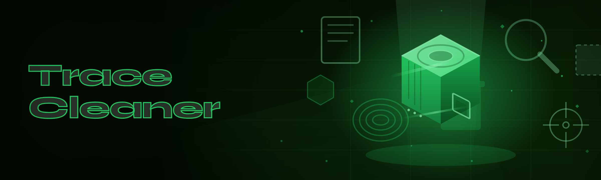

  
  
  

  

  
  
  
  

---

Trace Cleaner: wipes USN journal, event logs, prefetch and registry traces after cheat injection, spoofer use or executor runs.

## Overview

Trace Cleaner: wipes USN journal, event logs, prefetch and registry traces after cheat injection, spoofer use or executor runs.

  

## License

[MIT License](LICENSE)

  

